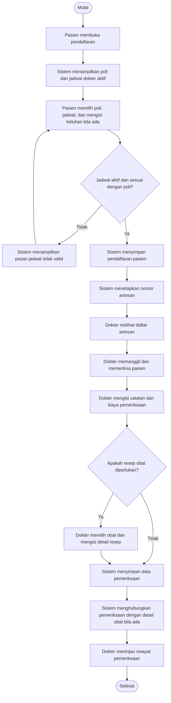

# Analisis Sistem Informasi Poliklinik

**Disusun oleh:** Verdy Harianja  
**NIM:** A11.2023.15358  
**Program Studi:** Teknik Informatika, Universitas Dian Nuswantoro  
**Objek:** Sistem Informasi Poliklinik (Poliklinik App)

> **Catatan kesesuaian dokumen UTS.** PDF `UTS_WEB_DEVELOPER.pdf` yang diberikan berisi ketentuan UTS mata kuliah Bengkel Koding, bukan rubrik laporan analisis Sistem Informasi. Dokumen itu meminta video presentasi dan demo aplikasi dengan materi sesuai kelas DEV-01 sampai DEV-05. Bagian DEV-05 berfokus pada proses pemeriksaan pasien, relasi tabel, serta operasi baca dan buat. Laporan ini disusun berdasarkan permintaan analisis Sistem Informasi dan kondisi project Poliklinik App. Jika tugas yang dikumpulkan adalah UTS Bengkel Koding, laporan ini dapat menjadi bahan penjelasan, tetapi tidak menggantikan ketentuan video dan pengumpulan yang tertulis pada PDF.

## 1. Profil Perusahaan

### 1.1 Identitas dan gambaran umum

Klinik Pratama Sehat Medika merupakan klinik fiktif yang berlokasi di Kota Semarang. Klinik memberikan layanan pemeriksaan kesehatan dasar kepada masyarakat melalui beberapa poli, antara lain poli umum dan poli gigi. Pelayanan diberikan oleh dokter yang memiliki jadwal praktik tertentu.

Operasional klinik meliputi pengelolaan data poli, dokter, pasien, dan obat; penetapan jadwal; pendaftaran pasien; pengaturan antrean; pemeriksaan; serta pencatatan resep dan riwayat pemeriksaan. Informasi tersebut saling berhubungan sehingga perlu dikelola secara terstruktur.

### 1.2 Aktor operasional

- **Admin** mengelola data master poli, dokter, pasien, dan obat.
- **Dokter** mengelola jadwal periksa, melihat antrean, melakukan pemeriksaan, menyimpan catatan serta biaya, memilih obat untuk resep, dan meninjau riwayat pasien.
- **Pasien** mendaftar berobat secara mandiri dengan memilih poli dan jadwal dokter yang tersedia.

### 1.3 Sistem yang dianalisis

Poliklinik App adalah aplikasi web yang dikembangkan menggunakan Laravel dengan antarmuka DaisyUI. Aplikasi mendukung pendaftaran pasien berdasarkan jadwal dokter, pencatatan pemeriksaan, pengisian detail obat pada resep, dan peninjauan riwayat pemeriksaan.

## 2. Latar Belakang

Proses pelayanan klinik melibatkan data yang memiliki hubungan satu sama lain. Pendaftaran harus terhubung dengan pasien dan jadwal dokter. Catatan pemeriksaan perlu terhubung dengan pendaftaran, sedangkan obat resep perlu dapat ditelusuri melalui detail pemeriksaan. Jika data tersebut dicatat tanpa keterkaitan yang jelas, klinik dapat mengalami kesulitan dalam mengatur antrean, menelusuri riwayat pasien, dan menjaga konsistensi informasi pelayanan.

Poliklinik App dikembangkan untuk mendukung alur pelayanan dalam satu aplikasi. Pasien memilih poli dan jadwal yang aktif, sistem mencatat pendaftaran beserta nomor antrean, kemudian dokter dapat melihat antrean dan menyimpan hasil pemeriksaan. Data pemeriksaan dan obat yang dipilih selanjutnya dapat ditinjau melalui riwayat pasien.

## 3. Rumusan Masalah

1. Bagaimana mengelola data poli, dokter, pasien, dan obat agar dapat digunakan dalam proses pelayanan klinik?
2. Bagaimana memfasilitasi pasien untuk mendaftar berdasarkan poli dan jadwal dokter yang tersedia?
3. Bagaimana menghubungkan pendaftaran pasien dengan antrean dan proses pemeriksaan oleh dokter?
4. Bagaimana menyimpan hasil pemeriksaan dan detail obat resep secara terstruktur serta menghubungkannya dengan riwayat pasien?
5. Bagaimana membatasi akses terhadap proses operasional sesuai peran admin, dokter, dan pasien?

## 4. Tujuan Pengembangan Sistem

1. Menyediakan pengelolaan data master poli, dokter, pasien, dan obat.
2. Memungkinkan pasien memilih poli dan jadwal dokter yang berstatus aktif untuk mendaftar.
3. Mencatat pendaftaran pasien dan nomor antrean agar dapat ditindaklanjuti dokter.
4. Memfasilitasi dokter mencatat tanggal pemeriksaan, catatan pemeriksaan, biaya, dan obat yang diresepkan.
5. Menghubungkan data pemeriksaan dengan detail obat untuk mendukung penelusuran riwayat pasien.
6. Menyediakan riwayat pemeriksaan yang dapat ditinjau dokter.

## 5. Ruang Lingkup dan Batasan

Analisis mencakup pengelolaan data master, jadwal dokter, pendaftaran pasien, antrean, pencatatan pemeriksaan, detail obat resep, dan riwayat pasien. Pengelolaan pembayaran terintegrasi, hasil laboratorium, klaim asuransi, dan proses lain yang tidak tampak pada ruang lingkup aplikasi tidak dibahas.

**Batasan kondisi implementasi:** tabel `obat` pada project menyimpan nama obat, kemasan, dan harga, tetapi belum mempunyai atribut stok. Proses penyimpanan pemeriksaan membuat data `periksa` dan `detail_periksa`, tetapi belum mengurangi stok obat. Dengan demikian, pengurangan stok merupakan kebutuhan pengembangan lanjutan, bukan fungsi yang sudah dapat dinyatakan berjalan pada implementasi saat ini. Selain itu, nilai biaya pemeriksaan yang disimpan saat ini menambahkan Rp150.000 pada nilai yang dikirim. Nilai tersebut perlu dicocokkan dengan kebijakan biaya klinik sebelum dijelaskan sebagai aturan bisnis final.

## 6. Identifikasi Proses Bisnis

### 6.1 Pengelolaan data master

1. Admin memilih data master yang akan dikelola.
2. Admin menambah, mengubah, atau menghapus data sesuai kebutuhan operasional.
3. Data poli, dokter, pasien, dan obat disimpan untuk digunakan dalam pelayanan.

**Aktor:** Admin.  
**Data utama:** `poli`, `users` (akun dokter/pasien sesuai peran), dan `obat`.  
**Keluaran:** data referensi operasional klinik.

### 6.2 Pengelolaan jadwal dokter

1. Dokter membuka fitur jadwal periksa.
2. Dokter membuat atau memperbarui hari dan rentang waktu praktik.
3. Jadwal disimpan dengan status yang digunakan aplikasi.
4. Pasien hanya ditampilkan jadwal yang berstatus aktif pada halaman pendaftaran.

**Aktor:** Dokter.  
**Data utama:** `jadwal_periksa` dan akun dokter pada `users`.  
**Keluaran:** jadwal dokter yang dapat dipilih pasien.

### 6.3 Pendaftaran dan pembentukan antrean

1. Pasien membuka halaman pendaftaran.
2. Sistem menampilkan daftar poli dan jadwal dokter aktif.
3. Pasien memilih poli, jadwal, dan dapat mengisi keluhan awal.
4. Sistem memvalidasi keberadaan poli dan jadwal serta memastikan jadwal aktif dan dokter pada jadwal sesuai dengan poli yang dipilih.
5. Jika data valid, sistem membuat pendaftaran menggunakan pasien yang sedang masuk ke aplikasi.
6. Sistem menentukan nomor antrean dengan menghitung jumlah pendaftaran pada jadwal tersebut, lalu menambahkan satu.
7. Pendaftaran tampil pada daftar pasien dokter.

Jika jadwal tidak valid atau tidak sesuai dengan poli, sistem mengembalikan pasien ke formulir dengan pesan kesalahan. Jika tidak ada jadwal aktif yang sesuai, pasien perlu memilih pilihan lain yang tersedia.

**Aktor:** Pasien dan sistem.  
**Data utama:** `daftar_poli`, `jadwal_periksa`, `poli`, dan akun pasien/dokter pada `users`.  
**Keluaran:** pendaftaran yang terhubung dengan jadwal dan nomor antrean.

### 6.4 Pemeriksaan pasien dan pencatatan resep

1. Dokter membuka daftar pasien yang terdaftar pada jadwal miliknya.
2. Dokter memilih pasien dari antrean dan melakukan pemeriksaan.
3. Dokter mengisi catatan dan biaya pemeriksaan.
4. Dokter memilih satu atau lebih obat dari daftar obat bila resep diperlukan.
5. Sistem menyimpan tanggal pemeriksaan dan data pemeriksaan pada tabel `periksa`.
6. Sistem menyimpan obat terpilih sebagai baris pada `detail_periksa`, yang menghubungkan pemeriksaan dengan obat.
7. Data pemeriksaan dapat ditampilkan pada riwayat pasien.

**Aktor:** Dokter dan sistem.  
**Data utama:** `daftar_poli`, `periksa`, `detail_periksa`, dan `obat`.  
**Keluaran:** catatan pemeriksaan dan rincian obat yang diresepkan.

### 6.5 Pemantauan riwayat pasien

1. Dokter membuka halaman riwayat pasien.
2. Sistem menampilkan pemeriksaan yang terkait dengan pendaftaran pada jadwal dokter tersebut.
3. Dokter dapat membuka rincian pemeriksaan, pasien, jadwal, dan obat yang tercatat.

**Aktor:** Dokter dan sistem.  
**Data utama:** `periksa`, `daftar_poli`, `users`, `jadwal_periksa`, `detail_periksa`, dan `obat`.  
**Keluaran:** informasi riwayat pemeriksaan pasien.

## 7. Pemodelan Proses Bisnis

Diagram berikut menggambarkan proses utama pendaftaran sampai pencatatan pemeriksaan. Kotak dalam kurung siku merupakan titik keputusan yang dapat digambar sebagai gateway pada BPMN atau decision node pada flowchart.

### 7.1 Pembagian swimlane yang disarankan

Untuk BPMN, gunakan tiga swimlane utama:

| Swimlane | Aktivitas |
|---|---|
| Pasien | Membuka pendaftaran, memilih poli dan jadwal, mengisi keluhan, mengirim pendaftaran |
| Sistem | Menampilkan data, memvalidasi pilihan, menyimpan pendaftaran dan nomor antrean, menyimpan pemeriksaan serta detail obat |
| Dokter | Mengelola jadwal, melihat antrean, memanggil pasien, memeriksa, mencatat hasil, memilih obat, meninjau riwayat |

Admin dapat ditambahkan sebagai swimlane terpisah jika diagram juga mencakup proses pengelolaan data master.

### 7.2 Data dan relasi yang perlu ditampilkan

- Satu jadwal periksa mengacu pada seorang dokter melalui `jadwal_periksa.id_dokter`.
- Pendaftaran mengacu pada pasien melalui `daftar_poli.id_pasien` dan pada jadwal melalui `daftar_poli.id_jadwal`.
- Data pemeriksaan mengacu pada pendaftaran melalui `periksa.id_daftar_poli`.
- Baris `detail_periksa` menghubungkan pemeriksaan dengan obat melalui `id_periksa` dan `id_obat`.
- Hubungan poli dokter ditentukan dari data dokter pada `users`, bukan melalui kolom poli di tabel jadwal.

## 8. Ringkasan Proses dan Data

| Proses | Aktor utama | Data utama | Hasil |
|---|---|---|---|
| Pengelolaan data master | Admin | Poli, akun dokter/pasien, obat | Data referensi pelayanan |
| Pengelolaan jadwal | Dokter | Dokter, jadwal periksa | Jadwal aktif untuk pendaftaran |
| Pendaftaran pasien | Pasien, sistem | Pasien, poli, jadwal, keluhan | Pendaftaran dan nomor antrean |
| Pemeriksaan | Dokter, sistem | Pendaftaran, catatan, biaya | Data pemeriksaan tersimpan |
| Pencatatan resep | Dokter, sistem | Pemeriksaan, detail periksa, obat | Relasi resep dengan obat tersimpan |
| Peninjauan riwayat | Dokter, sistem | Pasien, jadwal, pemeriksaan, obat | Riwayat pemeriksaan ditampilkan |

## 9. Kesimpulan

Poliklinik App mendukung alur utama pelayanan poliklinik mulai dari pendaftaran pasien berdasarkan jadwal dokter, pembentukan antrean, pemeriksaan, pencatatan obat resep, hingga peninjauan riwayat pasien. Struktur data menghubungkan pendaftaran dengan pasien dan jadwal, pemeriksaan dengan pendaftaran, serta detail pemeriksaan dengan obat. Berdasarkan kondisi project saat dokumen ini disusun, pengelolaan stok obat belum tercakup karena tabel obat belum menyimpan jumlah stok dan proses pemeriksaan belum melakukan pengurangan stok.

## 10. Hal yang Perlu Disesuaikan Sebelum Pengumpulan

1. Nama dan profil Klinik Pratama Sehat Medika adalah contoh fiktif; ganti bila menggunakan nama studi kasus lain.
2. Cocokkan kebijakan biaya pemeriksaan dengan implementasi dan keputusan bisnis yang akan dipresentasikan.
3. Jangan menyatakan stok obat otomatis berkurang sebelum fungsi dan kolom stok benar-benar tersedia.
4. Cocokkan format bab, diagram, dan gaya sitasi dengan instruksi dosen mata kuliah Sistem Informasi yang berlaku.
5. Jika materi yang dinilai adalah DEV-05 Bengkel Koding, gunakan pula istilah dan demo aktual dari controller, model, validasi, dan relasi tabel saat menjelaskan proses pemeriksaan.
